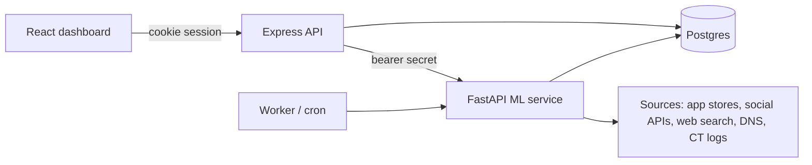

# OmniScout

Digital risk protection for brand impersonation. SignalGuard searches app stores, social platforms, the web and the domain space for accounts, apps, pages and domains that imitate a brand, scores each one with a trained model plus explainable phishing indicators, and gives analysts an investigation workflow with evidence, review decisions and an audit trail.

Scores are risk estimates to help prioritise review. They are not proof of impersonation, and no source or model here is 100% reliable.

## Live and Demo are separate

Every brand has a mode, and it never changes.

- **Live brands** are scanned only by live sources. If a source fails, the scan says so; nothing is filled in.
- **The demo brand** (fictional "Northstar") is scanned only against a hand-labelled dataset in `ml/data/seed_corpus.json`, so precision and recall can be measured. It never calls a live source, and its findings are labelled DEMO DATA everywhere.

## Run locally

Needs Node 20+, Python 3.11+ and Postgres 16 (`docker compose up -d` starts one with a `signalguard_test` database for tests).

```bash
npm install
python -m pip install -r ml/requirements-dev.txt
npm run setup:env -- you@example.com   # creates .env with random internal secrets and an admin password (kept only in .env)
npm run db:migrate
npm run dev                   # ML service :8000, worker, API :4000, web :5173
```

Open http://localhost:5173 (the Vite dev origins are accepted by the API outside production; set `APP_ORIGIN` for any other address) and sign in with `ADMIN_EMAIL` / `ADMIN_PASSWORD` (the first admin is created only when the users table is empty). Add more users from the Users page or with `npm run user:create -- someone@example.com analyst`.

`npm run build && npm start` serves the built dashboard and the API together on :4000 (run the ML service and worker alongside it).

## Checks

```bash
npm run check        # lint (eslint + ruff), type checks (tsc + mypy), all tests, production build
npm run test:js      # API (supertest, real Postgres) and dashboard (Testing Library, jsdom)
npm run release:gate  # secrets scan, audits, everything above, then a production-mode stack driven by a real browser
npm run sources:check # probes each keyed live source for real (needs internet and your keys)
npm run test:ml      # model, collectors (mocked HTTP), SSRF, web risk, worker (real Postgres), ML service
```

The Python tests cannot reach the internet (every non-local socket is blocked) and the JavaScript tests use fakes for the ML service. DB tests reset only a database whose name ends in `_test`. Live sources are checked separately with `npm run sources:check` on a machine that has internet access and your keys.

## Architecture



- **Express API** (`server/`): sessions (bcrypt + signed JWT in an httpOnly cookie), roles (viewer, analyst, admin), zod validation, rate limits, CSRF origin checks, helmet headers. Routes for brands, scans, findings, review decisions, evidence export, source health and the cron hook.
- **ML service** (`ml/service.py`): the trained ranker, look-alike tester, profile verification and the worker endpoint. Only the API calls it, with `ML_SERVICE_SECRET`.
- **Worker** (`ml/brandml/jobs.py`, `ml/worker.py`): scans are rows in `scans`, claimed with `FOR UPDATE SKIP LOCKED`, heartbeated, retried up to 3 times if a worker dies, then marked failed. Scheduled rescans come from each brand's interval. New High/Critical findings go to `ALERT_WEBHOOK_URL`.
- **Postgres** (`db/migrations/`): users, brands, allowlist, scans, findings, finding events (audit trail), source health, source cache and reviewer labels.

## How detection works

1. **Collect.** Each enabled source is searched with queries built from the brand profile (`ml/brandml/sources/`).
2. **Exclude confirmed official assets.** Only *confirmed* accounts and apps, domains with proof of control, and reviewer-allowlisted items are removed before scoring and listed in the scan. Suggested (guessed) and unverified (typed in) assets stay in the results, marked as matching a declared asset, so a wrong or attacker-made entry cannot hide a threat.
3. **Retrieve.** A TF-IDF character n-gram retriever drops candidates whose names are nothing like the brand.
4. **Rank.** A gradient-boosted model over 29 features (homoglyphs, leetspeak, typos, spacing variants, impersonation and scam words, publisher mismatch, perceptual-hash logo similarity) gives a probability for social accounts and apps.
5. **Domains and pages** get the model's name probability plus weighted, named indicators from `web_risk.py`: DNS and MX records, recent certificates, password forms, off-site form posts, phishing phrases, favicon similarity, redirects to the official site (scored down) and parked pages.
6. **Explain.** Every finding stores its reasons, factor points, source, query, timestamps and model version.

The model is trained on synthetic labelled pairs and evaluated on brands held out of training (`ml/models/metrics.json`). Those figures describe that synthetic benchmark, not real-world accuracy. The fictional demo brand is never part of training, so the demo precision and recall (hand-labelled, 32 items) are measured on a brand the model has not seen; a test enforces this. Analyst decisions on *live* findings (confirmed, false positive, official) are saved with who made them and are folded in by `npm run ml:train` only when at least 10 of each kind exist; demo decisions and rows of unknown origin are never used, and feedback is not part of the reported metrics. A resolved finding that a live scan sees again is reopened automatically with a note.

## Official assets and trust

Each declared asset is **suggested** (guessed from store search), **unverified** (typed in, nothing checked) or **confirmed**. Accounts and apps are confirmed by an analyst who records how they checked; platforms offer no ownership proof, so this is an attested, audited decision. A domain counts only after its owner proves control with a DNS TXT record (`_signalguard.<domain>`) or a file at `/.well-known/signalguard-verify.txt`. The demo brand's assets are synthetic and count as confirmed. Access is single tenant: every signed-in user sees every brand (roles limit what they can change).

Findings keep a copy of what each scan saw (`finding_observations`). When a complete scan of a healthy source no longer returns a finding it is marked "not seen in last N scans"; nothing is resolved automatically, and failed, partial or cached scans never count as absence.

## Sources

| Source | Access | Status without setup |
| --- | --- | --- |
| Apple App Store | iTunes Search API, no key | works |
| Google Play | public pages via google-play-scraper | works; Google may throttle |
| Bluesky | public AppView API | works |
| Mastodon | instance search; some instances need `MASTODON_TOKEN` | works on open instances |
| Look-alike domains | generated variants checked in DNS | works |
| Certificate Transparency | crt.sh JSON | works; often slow |
| Web search | `BRAVE_SEARCH_API_KEY` or `SERPAPI_API_KEY` | needs key (free tiers) |
| YouTube | `YOUTUBE_API_KEY` (10k units/day free) | needs key |
| Reddit | `REDDIT_CLIENT_ID`, `REDDIT_CLIENT_SECRET` | needs key; free for non-commercial use |
| X | `X_BEARER_TOKEN`, pay-per-use | paid, off until approved |
| Instagram | Graph API business discovery; exact business/creator usernames only | needs Meta setup |
| Threads | `threads_keyword_search` approval | needs Meta approval |
| Facebook Pages | Page Public Metadata Access | needs Meta approval |
| TikTok, LinkedIn, Telegram | no API allows this search | reported as unsupported |

Each scan records a status per source: ok, partial, cached (last good live results, with their time), rate limited, unavailable, key rejected, needs key, unsupported or off. The Source health page shows the access each one needs and its recent failures.

## Security notes

- Accounts: bcrypt hashes in Postgres, no public registration, first admin only from `ADMIN_EMAIL`/`ADMIN_PASSWORD` when the users table is empty. Sessions are revocable (logout, password change, disabling a user). Failed sign-ins are throttled per email and per address in Postgres. Admins reset passwords from the Users page; self-service recovery is not supported.
- The ML service requires `ML_SERVICE_SECRET` in production and answers `/health` with status only to callers without it.
- There is no CORS: the API accepts browser requests from `APP_ORIGIN` only.

- Discovered URLs are fetched only through `safe_http.fetch`: http(s) on ports 80/443, public addresses only; the connection goes to the address that was validated, so DNS cannot change between check and connect, three re-validated redirects at most, size caps, robots.txt honoured, no proxy environment.
- Secrets come from the environment only. `.env` is gitignored; error messages never include keys.
- CSV exports neutralise spreadsheet formulas. Search input is parameterised.

## Deployment

See [DEPLOYMENT.md](DEPLOYMENT.md). Nothing is deployed automatically.
